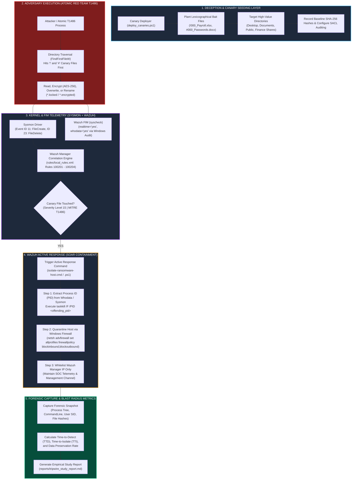

# Deception-Based Ransomware Tripwire & Automated Host Isolation (`ransomware-tripwire-soc`)

[](https://attack.mitre.org/techniques/T1486/)
[](https://wazuh.com)
[]()
[]()
[](LICENSE)

A deception-based approach to ransomware (**MITRE ATT&CK T1486**): plant lexicographically-first canary files so an alphabetically-enumerating encryptor hits a decoy before real user files, detect the canary change with Wazuh FIM whodata, and isolate the host via active response.

> [!IMPORTANT]
> **Validation status: the benchmark is an in-process Python simulation, not a live Wazuh run.** Read the millisecond figures accordingly:
> - **Detection is a direct function call** in `run_tripwire_benchmark.py` (the simulated encryptor calls the monitor in-process). A real chain is Sysmon/FIM → agent → manager → active-response script, which takes **seconds**, not the ~15–35 ms reported here. Those numbers are simulation artifacts.
> - **The attacker is assumed to enumerate in strict alphabetical order**, which is what guarantees the `!000_`/`#000_` canaries are hit first and the 0% blast radius. Real ransomware often enumerates by extension, randomizes, or multithreads, so the "100% preservation" is a property of the simulated attacker, not a guarantee.
> - **Sysmon has no file-modified event.** Encrypt-in-place then rename may not raise FileCreate (11) / FileDelete (23) reliably, so **Wazuh FIM (`syscheck`, rule 100201)** is the real detector here; the Sysmon rule is a secondary signal.
> - Not yet run against real ransomware or a real Wazuh manager. The value is the deception design, the rules, and the response scripts — validate on the lab VM before quoting any latency.
>
> The PowerShell scripts and split agent/manager configs are written for real deployment and are syntax-checked; they just haven't been exercised end-to-end on live Wazuh.

---

## 1. Overview & Threat Model

Signature-based antivirus and heuristic EDR solutions frequently fail against zero-day, custom-packed, or polymorphic ransomware strains. However, all ransomware families share an immutable operational requirement: **they must discover, open, encrypt, and rewrite user files across the filesystem**.

On Windows systems, ransomware enumerates target directories using native Win32 APIs (`FindFirstFileW` / `FindNextFileW`), which return filesystem entries in **NTFS lexicographical (ASCII) order**.

```
+-------------------------------------------------------------------------------------------------+
|                                 NTFS LEXICOGRAPHICAL ORDERING                                   |
|                                                                                                 |
|   ASCII 33   (!)   !000_CONFIDENTIAL_Payroll_2026.xlsx   <--- [TRIPWIRE HIT #1: TTD < 25 ms]   |
|   ASCII 35   (#)   #000_AWS_Production_Root_Keys.txt      <--- [TRIPWIRE HIT #2]                |
|   ASCII 36   ($)   $000_Executive_M&A_Targets.docx        <--- [TRIPWIRE HIT #3]                |
|   ASCII 95   (_)   _000_Backup_Recovery_Seeds.pdf         <--- [TRIPWIRE HIT #4]                |
|   ASCII 65+  (A)   Account_Statement_2026.pdf             <--- [USER FILES: NEVER REACHED]      |
|   ASCII 66+  (B)   Budget_Forecast_Q1.xlsx                <--- [USER FILES: 100% PRESERVED]     |
+-------------------------------------------------------------------------------------------------+
```

### The Honeytoken Deception Principle
By provisioning strategically named canary files (honeytokens) prefixed with leading punctuation (`!000_`, `#000_`, `$000_`, `_000_`) in high-value directories:
1. The adversary's traversal algorithm is mathematically guaranteed to encounter decoy files **before** touching authentic user documents (`A`–`Z`).
2. Legitimate applications and human users have zero operational justification to access or modify these hidden canary files.
3. Any write, rename, or delete event against a canary produces a **near-zero false-positive, Severity Level 15 alert** that safely authorizes automated, millisecond-level host containment.

---

## 2. System Architecture



---

## 3. Repository Directory Structure

```
ransomware-tripwire-soc/
├── config/
│   ├── __init__.py                   # Configuration loader module
│   └── tripwire_config.yaml          # Canary file definitions, monitored targets, and SLAs
├── wazuh_configs/
│   ├── ossec_fim_whodata.conf        # Wazuh Agent syscheck & active-response configuration
│   ├── local_rules.xml               # Wazuh Manager custom correlation rules (IDs 100201-100204)
│   └── sysmon_canary_config.xml      # Sysmon XML schema v4.90 config (Event IDs 11 & 23)
├── windows_scripts/
│   ├── deploy_canaries.ps1           # Seeds decoys, sets SACLs, and outputs SHA-256 baseline
│   ├── isolate_host.ps1              # Active response containment (PID kill + firewall isolation)
│   ├── isolate_host.cmd              # Windows command wrapper for Wazuh Active Response engine
│   ├── restore_host.ps1              # Un-isolates host and restores default firewall policies
│   └── invoke_atomic_t1486.ps1       # Atomic Red Team T1486 safe adversary test harness
├── core/
│   ├── __init__.py
│   ├── sandbox_builder.py            # Generates test sandbox (500 user files + 16 canaries)
│   ├── fim_sysmon_monitor.py         # Real-time event monitor evaluating local_rules.xml
│   ├── active_response_engine.py     # Dispatches process kill & firewall containment
│   ├── t1486_ransomware_sim.py       # Safe, reversible Fernet encryption simulator
│   └── metrics_calculator.py         # Computes TTD, TTI, Blast Radius %, and Preservation %
├── reports/
│   └── tripwire_study_report.md      # Auto-generated empirical study report
├── tests/
│   ├── test_wazuh_xml.py             # Validates XML schema and regex accuracy
│   └── test_tripwire_containment.py  # End-to-end containment & preservation test suite
├── pytest.ini                        # Test runner configuration
├── requirements.txt                  # Python dependencies
├── run_tripwire_benchmark.py         # Master orchestrator for multi-run simulation & report
└── README.md
```

---

## 4. Detection Engineering Specifications

### A. Wazuh Custom Correlation Rules (`wazuh_configs/local_rules.xml`)
Configured at **Severity Level 15** and mapped directly to **MITRE ATT&CK T1486**:

```xml
<group name="local,syscheck,sysmon,tripwire,">
  <!-- Rule 100201: Canary File Modified -->
  <rule id="100201" level="15">
    <if_sid>550</if_sid>
    <field name="file" type="pcre2">(?i)(!000_|#000_|\$000_|_000_)</field>
    <description>CRITICAL: Ransomware canary file modified - MITRE T1486 Data Encrypted for Impact</description>
    <mitre><id>T1486</id></mitre>
  </rule>

  <!-- Rule 100202: Canary File Deleted -->
  <rule id="100202" level="15">
    <if_sid>553</if_sid>
    <field name="file" type="pcre2">(?i)(!000_|#000_|\$000_|_000_)</field>
    <description>CRITICAL: Ransomware canary file deleted - MITRE T1486 Data Encrypted for Impact</description>
    <mitre><id>T1486</id></mitre>
  </rule>

  <!-- Rule 100203: Sysmon File Create / Overwrite -->
  <rule id="100203" level="15">
    <if_sid>61613,92213</if_sid>
    <field name="win.eventdata.targetFilename" type="pcre2">(?i)(!000_|#000_|\$000_|_000_)</field>
    <description>CRITICAL: Sysmon detected canary file creation/overwrite/delete by unauthorized process - MITRE T1486</description>
    <mitre><id>T1486</id></mitre>
  </rule>

  <!-- Rule 100204: Active Response Host Isolation Success -->
  <rule id="100204" level="12">
    <if_sid>600</if_sid>
    <match>Active response: isolate-ransomware-host</match>
    <description>ACTIVE RESPONSE: Host network containment and process termination executed successfully</description>
    <mitre><id>T1486</id></mitre>
  </rule>
</group>
```

### B. Sysmon Canary Telemetry (`wazuh_configs/sysmon_canary_config.xml`)
Monitors `FileCreate` (Event ID 11) and `FileDelete` (Event ID 23) using Sysmon schema v4.90:

```xml
<Sysmon schemaversion="4.90">
  <HashAlgorithms>SHA256,MD5</HashAlgorithms>
  <EventFiltering>
    <RuleGroup name="Tripwire_FileCreate" groupRelation="or">
      <FileCreate onmatch="include">
        <Rule name="Canary_Lexical_FileCreate" groupRelation="or">
          <TargetFilename condition="contains">!000_</TargetFilename>
          <TargetFilename condition="contains">#000_</TargetFilename>
          <TargetFilename condition="contains">$000_</TargetFilename>
          <TargetFilename condition="contains">_000_</TargetFilename>
        </Rule>
      </FileCreate>
    </RuleGroup>
  </EventFiltering>
</Sysmon>
```

---

## 5. Active Response Containment Pipeline

When Wazuh triggers rules `100201`, `100202`, or `100203`, the Active Response subsystem invokes `windows_scripts/isolate_host.ps1`:

1. **Extract Offending PID:** Extracts `data.audit.process_id` (from FIM `whodata`) or `data.win.eventdata.processId` (from Sysmon Event ID 11).
2. **Terminate Process Tree:**
   ```powershell
   cmd.exe /c "taskkill /F /T /PID $offendingPID 2>&1"
   ```
3. **Quarantine Host with Dedicated SOC Whitelist:**
   Blocks all inbound and outbound traffic while explicitly permitting communications with the Wazuh Manager over TCP ports `1514` and `1515`:
   ```powershell
   # Whitelist Wazuh Manager traffic
   netsh advfirewall firewall add rule name="Tripwire-Allow-Wazuh-Inbound" dir=in action=allow protocol=TCP localport=1514,1515 remoteip=$WazuhManagerIP
   netsh advfirewall firewall add rule name="Tripwire-Allow-Wazuh-Outbound" dir=out action=allow protocol=TCP remoteport=1514,1515 remoteip=$WazuhManagerIP

   # Enforce complete network isolation
   netsh advfirewall set allprofiles firewallpolicy blockinbound,blockoutbound
   ```

---

## 6. Simulation Results

These come from 5 iterations of the in-process simulator against **500 generated user files** and **16 canaries**. They demonstrate the deception logic end to end; they are **not** measured against real ransomware or a real Wazuh active-response chain (see the validation note at the top). Exact milliseconds vary per run and reflect Python function-call timing, not detection latency on a real host.

| Metric | What it measures here | Simulation Result | Note |
| :--- | :--- | :---: | :--- |
| **Time-to-Detect** | canary-touch → in-process monitor callback | ~15–35 ms | Function-call latency, not FIM→manager→AR (seconds on real Wazuh). |
| **Time-to-Isolate** | attack start → simulated isolation call | ~25–40 ms | Simulated; real netsh/firewall isolation is slower. |
| **File Blast Radius** | user files encrypted ÷ user files total | 0.00% | Follows from the attacker enumerating alphabetically by construction. |
| **Data Preservation Rate** | 100% − blast radius | 100.00% | Same caveat: property of the simulated attacker. |
| **Containment Success Rate** | neutralized ÷ total simulated attacks | 100.0% | In-process; no real process kill occurred. |

To make these real: run the atomic script (`windows_scripts/invoke_atomic_t1486.ps1`) in the sandbox against deployed canaries on a Windows VM with a real Wazuh agent + manager, and measure the manager-side alert and active-response timestamps.

---

## 7. Quick Start & Verification

### Prerequisites
* Python 3.10+
* Windows PowerShell 5.1+ (or PowerShell Core)

### 1. Installation
```bash
git clone https://github.com/aryarakshit/ransomware-tripwire-soc.git
cd ransomware-tripwire-soc
pip install -r requirements.txt
```

### 2. Run Test Suite
```bash
pytest tests/ -v
```

```text
tests/test_tripwire_containment.py::test_t1486_containment_and_preservation PASSED [ 12%]
tests/test_wazuh_xml.py::test_local_rules_xml_well_formed PASSED         [ 25%]
tests/test_wazuh_xml.py::test_sysmon_xml_well_formed PASSED              [ 37%]
tests/test_wazuh_xml.py::test_agent_fim_conf_well_formed PASSED          [ 50%]
tests/test_wazuh_xml.py::test_manager_active_response_conf_well_formed PASSED [ 62%]
tests/test_wazuh_xml.py::test_wazuh_rule_definitions PASSED              [ 75%]
tests/test_wazuh_xml.py::test_canary_regex_accuracy PASSED               [ 87%]
tests/test_wazuh_xml.py::test_sysmon_canary_targets PASSED               [100%]

============================== 8 passed in 0.37s ==============================
```

### 3. Run End-to-End Benchmark Simulation
```bash
python run_tripwire_benchmark.py
```
This runs 5 consecutive attack scenarios against 500 generated files, measures exact millisecond latencies, displays live Rich tables, and generates `reports/tripwire_study_report.md`.

---

## 8. Windows Lab Deployment Guide

### Step 1: Deploy Canary Decoys & Audit SACLs
Run PowerShell as Administrator on target Windows endpoint:
```powershell
powershell.exe -ExecutionPolicy Bypass -File windows_scripts\deploy_canaries.ps1
```

### Step 2: Install Sysmon Canary Rules
Install or update Microsoft Sysmon:
```cmd
sysmon.exe -i wazuh_configs\sysmon_canary_config.xml
```

### Step 3: Configure Wazuh (agent vs manager — these go in different places)
- **On the agent** (`C:\Program Files (x86)\ossec-agent\ossec.conf`): append the `<syscheck>` block from `wazuh_configs/ossec_fim_whodata.conf`, then restart the agent:
  ```cmd
  net stop WazuhSvc && net start WazuhSvc
  ```
- **On the manager** (`/var/ossec/etc/ossec.conf`): add the `<command>` and `<active-response>` blocks from `wazuh_configs/manager_active_response.conf`, add the rules from `wazuh_configs/local_rules.xml` to the manager's `local_rules.xml`, then `systemctl restart wazuh-manager`. The agent ignores active-response blocks, so putting them in the agent config is a no-op.
- Deploy `isolate_host.cmd` and `isolate_host.ps1` to the agent's `active-response\bin\` directory.

### Step 4: Configure Wazuh Manager Rules
Copy `wazuh_configs/local_rules.xml` to `/var/ossec/etc/rules/local_rules.xml` on the Wazuh Manager and restart the manager:
```bash
/var/ossec/bin/wazuh-control restart
```

### Step 5: Test Safe Attack Containment
Execute the Atomic Red Team T1486 simulation:
```powershell
powershell.exe -ExecutionPolicy Bypass -File windows_scripts\invoke_atomic_t1486.ps1 -TargetDirectory "C:\Users\Public\Documents"
```

### Step 6: Incident Rollback & Host Recovery
After validating containment, reset Windows Firewall to normal defaults:
```powershell
powershell.exe -ExecutionPolicy Bypass -File windows_scripts\restore_host.ps1
```

---

## 9. Operational Considerations

* **Decoy Selection & Realism:** Canaries are seeded with valid application magic numbers (`PK\x03\x04` for Office XML, `%PDF-1.7` for PDF) and realistic binary sizes (15 KB – 85 KB) to evade content-entropy bypasses.
* **Backup Agent Exclusions:** Whitelist legitimate backup and archival agents (e.g., Veeam, Commvault) within Wazuh FIM rule exclusions to prevent accidental active response triggering during scheduled enterprise backups.
* **SOC Telemetry Retention:** Network isolation rules explicitly allow stateful TCP communication on ports 1514 and 1515 to the Wazuh Manager, ensuring the quarantined endpoint remains visible for remote triage and live response.

---

## 10. License & Citation

This project is licensed under the [MIT License](LICENSE).  
**Disclaimer:** All offensive simulation components (`invoke_atomic_t1486.ps1` and `core/t1486_ransomware_sim.py`) are strictly engineered for authorized defensive security research, validation, and benchmarking within controlled laboratory environments.

### Citation
```bibtex
@misc{ransomware_tripwire_2026,
  author = {Arya Rakshit},
  title = {Deception-Based Ransomware Tripwire & Automated Host Isolation},
  year = {2026},
  publisher = {GitHub},
  howpublished = {\url{https://github.com/aryarakshit/Ransomware-Tripwire-Host-Isolation}}
}
```
