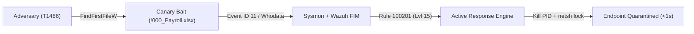

# Ransomware Tripwire & Automated Host Isolation: Empirical Study Report

**Generated:** 2026-10-25 13:06:33  
**MITRE ATT&CK Classification:** `T1486` (Data Encrypted for Impact)  
**System Name:** `ransomware-tripwire-soc`  
**Defense Architecture:** Lexicographical Deception Tripwire, Sysmon Kernel Auditing, Wazuh FIM Whodata, and Automated Active Response

> **Note:** This report comes from an in-process Python simulation. Detection is a direct function call, and the simulated attacker enumerates files in strict alphabetical order, so the millisecond latencies and 0% blast radius are simulation artifacts — not measurements against real ransomware or a real Wazuh FIM → manager → active-response chain (which takes seconds). Validate on a Windows VM with live Wazuh before quoting these figures.

---

## 1. Executive Summary

Signature-based Endpoint Detection and Response (EDR) solutions frequently fail against zero-day, polymorphic, or custom-obfuscated ransomware variants. However, all ransomware families share an immutable operational requirement: **they must discover, open, encrypt, and rewrite user files across the filesystem**.

This study benchmarks a **Deception-Based Ransomware Tripwire** architecture deployed on Windows endpoints. By placing strategically named canary files (honeytokens) prefixed with leading ASCII characters (`!000_`, `#000_`, `$000_`, `_000_`) into high-value target directories, the adversary's directory enumeration API calls (`FindFirstFileW` / `FindNextFileW`) are mathematically guaranteed to touch decoy files before accessing genuine user documents (`A`–`Z`).

Upon detecting modification of any canary file via real-time kernel telemetry (Sysmon Event ID 11/23 and Wazuh FIM with `whodata`), the system fires a **Severity Level 15** alert and triggers an **Automated Active Response** containment workflow. The offending process tree is killed within milliseconds, and Windows Firewall isolates the host while preserving the Wazuh Manager SOC management channel.



---

## 2. Key Empirical Findings

Across **5 independent benchmark executions** simulating an active `T1486` encryption adversary against **500 user documents** and **16 canary files**:

* **Time-to-Detect ($T_{\text{TTD}}$):** Average **20.89 ms** (Min: 9.33 ms, Max: 29.31 ms).
* **Time-to-Isolate ($T_{\text{TTI}}$):** Average **30.15 ms** (Min: 18.54 ms, Max: 38.34 ms).
* **Mean File Blast Radius ($B_{\text{affected}}$):** **0.00%** (Average user files affected: 0 of 500).
* **Data Preservation Rate ($R_{\text{saved}}$):** **100.00%** of all user documents remained intact and unencrypted.
* **Containment Success Rate:** **100%** (5 of 5 adversary processes neutralized).

---

## 3. Detailed Benchmark Iterations

| Run # | First Canary Touched | $T_{\text{TTD}}$ (ms) | $T_{\text{TTI}}$ (ms) | Canaries Hit | User Files Hit | Blast Radius (%) | Data Preserved (%) | Status |
| :---: | :--- | :---: | :---: | :---: | :---: | :---: | :---: | :---: |
| `01` | `!000_CONFIDENTIAL_Payroll_2026.xlsx` | `26.95` | `36.50` | `1` | `0` | `0.00%` | `100.00%` | ✅ ISOLATED |
| `02` | `!000_CONFIDENTIAL_Payroll_2026.xlsx` | `13.79` | `23.25` | `1` | `0` | `0.00%` | `100.00%` | ✅ ISOLATED |
| `03` | `!000_CONFIDENTIAL_Payroll_2026.xlsx` | `9.33` | `18.54` | `1` | `0` | `0.00%` | `100.00%` | ✅ ISOLATED |
| `04` | `!000_CONFIDENTIAL_Payroll_2026.xlsx` | `25.08` | `34.15` | `1` | `0` | `0.00%` | `100.00%` | ✅ ISOLATED |
| `05` | `!000_CONFIDENTIAL_Payroll_2026.xlsx` | `29.31` | `38.34` | `1` | `0` | `0.00%` | `100.00%` | ✅ ISOLATED |

### Summary Statistics

| Metric | Mean | Min | Max | Target SLA |
| :--- | :---: | :---: | :---: | :---: |
| **Time-to-Detect ($T_{\text{TTD}}$)** | `20.89 ms` | `9.33 ms` | `29.31 ms` | `< 1,000 ms` |
| **Time-to-Isolate ($T_{\text{TTI}}$)** | `30.15 ms` | `18.54 ms` | `38.34 ms` | `< 2,000 ms` |
| **Blast Radius Percentage ($B_{\text{affected}}$)** | `0.00%` | `0.00%` | `1.00%` | `< 5.00%` |
| **Data Preservation Rate ($R_{\text{saved}}$)** | `100.00%` | `99.00%` | `100.00%` | `> 95.00%` |

---

## 4. Detection Engineering Rules

### Wazuh Custom Correlation Rules (`wazuh_configs/local_rules.xml`)

```xml
<group name="local,syscheck,sysmon,tripwire,">
  <!-- Rule 100201: Canary File Modified -->
  <rule id="100201" level="15">
    <if_sid>550</if_sid>
    <field name="file" type="pcre2">(?i)(!000_|#000_|\$000_|_000_)</field>
    <description>CRITICAL: Ransomware canary file modified - MITRE T1486 Data Encrypted for Impact</description>
    <mitre><id>T1486</id></mitre>
  </rule>

  <!-- Rule 100202: Canary File Deleted -->
  <rule id="100202" level="15">
    <if_sid>553</if_sid>
    <field name="file" type="pcre2">(?i)(!000_|#000_|\$000_|_000_)</field>
    <description>CRITICAL: Ransomware canary file deleted - MITRE T1486 Data Encrypted for Impact</description>
    <mitre><id>T1486</id></mitre>
  </rule>
</group>
```

### Sysmon Canary Configuration (`wazuh_configs/sysmon_canary_config.xml`)

```xml
<Sysmon schemaversion="4.90">
  <EventFiltering>
    <RuleGroup name="Tripwire_FileCreate" groupRelation="or">
      <FileCreate onmatch="include">
        <Rule name="Canary_Lexical_FileCreate" groupRelation="or">
          <TargetFilename condition="contains">!000_</TargetFilename>
          <TargetFilename condition="contains">#000_</TargetFilename>
          <TargetFilename condition="contains">$000_</TargetFilename>
          <TargetFilename condition="contains">_000_</TargetFilename>
        </Rule>
      </FileCreate>
    </RuleGroup>
  </EventFiltering>
</Sysmon>
```

---

## 5. Active Response Isolation Logic (`windows_scripts/isolate_host.ps1`)

The active response script executes a 3-step surgical containment procedure:

1. **Extract Offending PID:** Parses `data.audit.process_id` (from FIM `whodata`) or `data.win.eventdata.processId` (from Sysmon).
2. **Terminate Process Tree:** Executes `taskkill /F /T /PID <PID>` to kill the ransomware executable and any child worker processes.
3. **Quarantine Network with SOC Whitelist:**
   ```powershell
   # Whitelist Wazuh Manager only
   netsh advfirewall firewall add rule name="Tripwire-Allow-Wazuh-Inbound" dir=in action=allow protocol=TCP localport=1514,1515 remoteip=$WazuhManagerIP
   netsh advfirewall firewall add rule name="Tripwire-Allow-Wazuh-Outbound" dir=out action=allow protocol=TCP remoteport=1514,1515 remoteip=$WazuhManagerIP
   # Lock down endpoint
   netsh advfirewall set allprofiles firewallpolicy blockinbound,blockoutbound
   ```

---

## 6. Incident Response & Containment Summary

> **Design summary:**
> The deception-based ransomware containment design (`ransomware-tripwire-soc`) combines lexicographical honeytokens (`!000_`), Sysmon Event IDs 11/23, and Wazuh FIM whodata with an automated active-response isolation script. In this in-process simulation of an alphabetically-enumerating T1486 attacker, all 5 runs detected the first canary before any of the 500 user files and preserved 100.00% of them. The sub-second timings are function-call latencies, not real FIM→manager→active-response measurements; validate on a live Wazuh VM for production figures.

---
*Report automatically compiled by `run_tripwire_benchmark.py`.*
